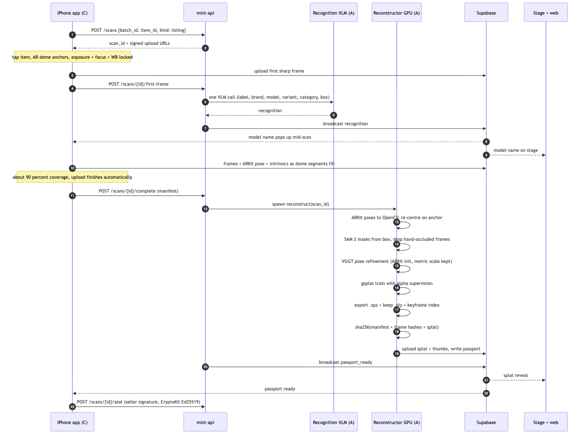
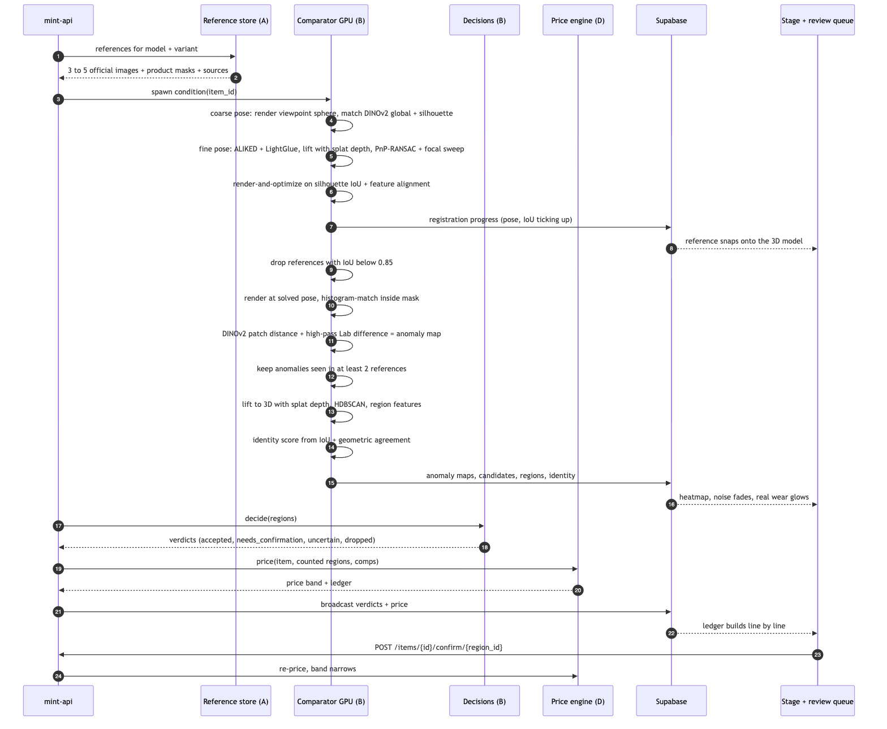
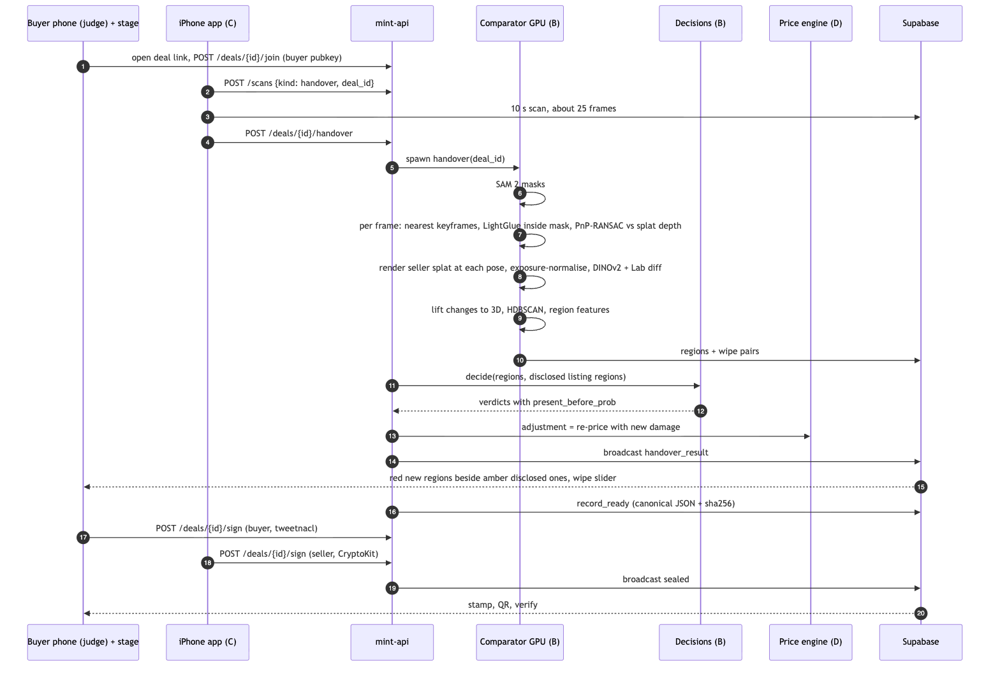

# Mint — End-to-end Architecture (v3)

*Mint makes your belongings verifiable, priceable and liquid.*
Hack the Valley 11 · Theme: Sustainable FinTech & Economic Inclusion · H0 = Fri Oct 16 2026, 10:00 PM ET → H34 = Sun Oct 18, 8:00 AM ET

The game plan, owners and schedule are in [CLAUDE.md](CLAUDE.md). The demo runbook is in [DEMO.md](DEMO.md). This doc says **how the system works**.

**Principles:** deterministic first, models second · contracts before code · real scans and real reference images only · every gate demoable end to end · show the tech (the stage view makes the pipeline visible).

---

## 1. System at a glance


*Source: [docs/diagrams/v3-overview.mmd](docs/diagrams/v3-overview.mmd). Edit the source, then re-render (see [docs/diagrams/README.md](docs/diagrams/README.md)).*

**One engine, three uses.** Everything rests on **render-and-compare**: because the item is a 3D Gaussian splat, we can render it from the exact camera pose of any other image and compare like with like.

| Use | Compared against | Output |
|---|---|---|
| **Listing condition** (Pipeline 2) | The manufacturer's official reference images | Wear, damage and missing-part regions + an identity match score |
| **Fair price** (§7) | The confirmed regions + comparable sales | A price band where every deduction links to a 3D region |
| **Handover** (Pipeline 3) | The seller's own splat | New regions (red) vs disclosed regions (amber) + a signed record |

**Components and owners**

| Component | Runs on | Owner | Job |
|---|---|---|---|
| iOS capture app | iPhone (Swift, ARKit, SwiftUI, RealityKit) | C | Tap-to-anchor, AR dome, pose-tagged frames, live recognition display, upload, seller key (CryptoKit) |
| `mint-api` | Modal CPU (FastAPI) | D (skeleton) + route owners | Orchestration, contracts, DB writes, Realtime broadcasts, decisions, price, records |
| `Reconstructor` | Modal GPU class | A | Recognition call, SAM 2 + hand filter, ARKit → VGGT pose refine, gsplat train + export, keyframe index |
| Reference store | Repo data + Storage | A | Curated official images (3–5 per demo object), product masks, sources |
| `Comparator` | Modal GPU class | B | Splat rendering, reference registration, anomaly maps, 3D lifting + clustering, identity check, handover localization + diff |
| Decision harness | Modal CPU (in API) | B | Jev or fallback classifier → probabilities; code rules → decisions |
| Fair price engine | Modal CPU (in API) | D | Comps × condition → band + ledger; household statement; handover adjustment |
| Record builder | Modal CPU (in API) | D | Canonical JSON, SHA-256, signature verification |
| Supabase | Hosted | D (schema) | Postgres, Storage, Realtime |
| Web app | Vercel (Next.js) | D (product pages), C (stage view + demo player) | Sale page, statement, passport, review queue, handover result, verify, stage |

**Why it's shaped like this**
- **Two warm GPU classes** (A's `Reconstructor`, B's `Comparator`), each with all its models already in memory. No cold starts and no data moving between containers, which protects the 100 s, 15 s and 20 s budgets. They deploy independently.
- **The API is thin.** Decisions, pricing and records are fast, pure Python, so they run in the API process.
- **Supabase is the shared bus.** Storage holds the bytes, Postgres holds the truth, Realtime pushes to the stage and phones.
- **The stage view is a first-class client.** Every pipeline step emits events rich enough to animate (registration poses with IoU, anomaly maps, candidates, ledger lines), so the stage can visualize live and cached runs identically.

---

## 2. Conventions (locked at H1)

These are the most likely sources of integration bugs.

| Topic | Rule |
|---|---|
| **Scan frame (world)** | For each **listing scan**: the ARKit world frame of that session, **translated so the origin is the tap anchor**. **+Y up (gravity)**, metres, X/Z horizontal (ARKit's arbitrary heading). Every 3D quantity for an item (centroids, poses, keyframes, registrations, regions) is in its listing scan frame. |
| **Handover scans** | Have their own ARKit session and frame. B localizes each handover frame **into the listing scan frame** (PnP); handover regions are reported in the listing frame. |
| **Manifest poses (C → A)** | **Raw ARKit** `frame.camera.transform` (camera-to-world, ARKit camera axes: +x right, +y up, +z toward the viewer), plus the `anchor` position in that same ARKit world. C does **no** conversion. |
| **Internal poses (A → everyone)** | `pose` = **camera-to-world 4×4, OpenCV camera convention** (+x right, +y down, +z forward), in the scan frame. A converts once on ingest: `T_cv = translate(−anchor) · T_arkit · diag(1, −1, −1, 1)`. |
| **Intrinsics** | `K` 3×3 in **pixels of the saved JPEG**. ARKit's `camera.intrinsics` refer to `capturedImage` in **sensor (landscape) orientation**. **Default (D2):** C saves frames in sensor orientation (landscape, e.g. 1440×1080, downscaled from 1920×1440) and scales `fx, fy, cx, cy` by the same factor. If C rotates images to portrait, K must be rotated with them; don't do this unless agreed at H1. |
| **Viewer** | three.js/Spark is +Y up like the scan frame, so there's **no world transform**. For rendering from a stored OpenCV pose, flip the camera axes back: `T_three = T_cv · diag(1, −1, −1, 1)`. |
| **Reference images** | Have **unknown intrinsics**. B solves focal length along with pose (§4). Stored at native resolution with a product mask. |
| **IDs** | UUIDv4: `batch_id`, `item_id`, `scan_id`, `ref_id`, `region_id`, `deal_id`, `record_id`. |
| **Money** | API and UI: CAD numbers. **Signed records: integer cents.** |
| **Probabilities, scores** | API: floats 0–1. **Signed records: integer basis points** (0–10000). |
| **Paths** | Storage object keys only, never full URLs. |
| **Versioning** | Every contract carries `"v": 3`. Breaking change → bump + ack from every consumer. |
| **Every listing belongs to a batch** | A single-item listing is a batch of 1, so there's one code path for garage sale mode (D15). |

---

## 3. Pipeline 1 — scan to passport



*Source: [docs/diagrams/pipeline-1-scan-to-passport.mmd](docs/diagrams/pipeline-1-scan-to-passport.mmd).*

| # | Step | Owner | How | Budget |
|---|---|---|---|---|
| 1 | **Capture** | C | User taps the item → raycast onto the detected horizontal plane → `ARAnchor`. An AR dome of segments at **two elevations** (e.g. ~20° and ~50°, 12 azimuth segments each = 24 segments) appears around the anchor. Each frame: direction anchor → camera picks a segment. If the segment is empty and the frame is sharp (Laplacian variance on a small thumbnail, plus low angular velocity from ARKit), save the JPEG + raw ARKit pose + intrinsics + `segment` id. **Exposure, focus and white balance lock at scan start.** ~50–60 frames in 20–25 s. | — |
| 2 | **Upload** | C | `POST /scans` → `scan_id` + signed URLs. The first sharp frame uploads at once, then `POST /scans/{id}/first-frame`. The rest stream as captured (4 in flight). At **≥ 90% coverage** the app finishes automatically: manifest + `POST /scans/{id}/complete`. | 15 s |
| 3 | **Live recognition** | A | One VLM call on the first frame, strict JSON output: `label, brand, model, variant, category, bbox_xyxy (normalised), confidence`. Broadcast `recognition` → it pops up on the phone and stage mid-scan. | ≤ 5 s to screen |
| 4 | **Masking** | A | SAM 2 video predictor seeded with the bbox. **Hand filter:** drop frames where a hand overlaps the object mask (a hand/person segmentation, or a second SAM 2 prompt; a frame is dropped if overlap > ~2% of the object mask). | 15 s incl. step 3 |
| 5 | **Poses** | A | Convert ARKit poses to OpenCV in the scan frame (§2). **ARKit gives the initialization and metric scale**; VGGT refines on the masked frames. Align the VGGT output to the ARKit poses with Sim(3) and keep ARKit's metric scale. If refinement makes things worse (reprojection check), keep the ARKit poses. | 10 s |
| 6 | **Training** | A | gsplat with alpha loss against the item mask (random background colour per step so the background stays empty). Gaussian cap ≤ ~300k for mobile. Iterations tuned to budget (start at ~3–5k). | 60 s incl. step 7 |
| 7 | **Export** | A | `.ply` stays on Modal Volume `mint-work` (B renders from it). `.spz` → `public/splats/{scan_id}.spz` (Spark). Keyframe index `{index, pose, K, sharpness, segment, thumb_path}`. Item-masked thumbnails → `public/thumbs/`. `coverage_pct` from filled segments → **coverage-verified badge** at ≥ 90%. | — |
| 8 | **Seal** | A computes, phone signs | `scan_sha256` (§8). The app receives `passport_ready` and signs with the seller key (CryptoKit Ed25519, Keychain) → `POST /scans/{id}/seal`. | — |
| 9 | **Kick off Pipeline 2** | API | `passport_ready` automatically triggers `POST /items/{id}/condition`, which can also be called manually (the demo runs it live on a cached splat). | — |
| | **Scan → passport** | | | **≤ 100 s** |

**Capture fallbacks** (decided by H6 if the AR app is behind):
1. **Apple Object Capture** on a LiDAR iPhone as the front end.
2. **Hand-held video** with VGGT-only poses; coverage is shown after upload, with no metric scale from ARKit, so measurements are relative only.

---

## 4. Pipeline 2 — condition vs. references (the core)



*Source: [docs/diagrams/pipeline-2-condition-vs-references.mmd](docs/diagrams/pipeline-2-condition-vs-references.mmd).*

### 4.1 References (A)

- **3–5 official images per demo object**, curated before H0 or in the first hours: `data/refs/{model_key}/` with `refs.json` (`ref_id, file, source_url, variant, notes`). Image search for other items is best effort.
- **Prefer** real product photos of the **exact variant** (colour), from varied angles, with a clean background. **Avoid** renders with fake materials, exploded views, lifestyle shots with occlusion, and photos of a different variant.
- **Product mask** per reference: SAM 2 (box = whole product) or a threshold on studio white. Stored next to the image.
- **Choose asymmetric demo objects.** Registration is ambiguous on symmetric shapes.

### 4.2 Registration (B): solving where the reference "camera" was

| Step | How | Notes |
|---|---|---|
| **Coarse pose** | Pre-render the splat from a **sphere of viewpoints** (e.g. 8 elevations × 24 azimuths, low resolution, 3 focal lengths). Score each against the reference: **DINOv2 global cosine** + **silhouette IoU** after centring and scaling both masks to the same bbox. Keep the top-k. | Pre-render once per splat right after training (cache on `mint-work`), so registration time is spent only on matching. |
| **Fine pose** | ALIKED (or SuperPoint) + LightGlue between the reference and the best render, matches inside both masks. Lift render keypoints to 3D with **splat-rendered depth**. **PnP-RANSAC with a focal sweep** (try ~5 focal lengths, keep the best inlier count and reprojection error). | Stock photos are often long-lens (near-orthographic), so a large focal is common. |
| **Refine** | **Render-and-optimize**: gradient descent on camera pose + focal through gsplat's differentiable rasterizer, minimizing `(1 − soft silhouette IoU)` + λ·keypoint reprojection error. ~50–100 iterations at reduced resolution. Emit `registration_progress` every ~10 iterations (pose + IoU) for the stage "snap" animation. | Stop early when IoU plateaus. |
| **Accept** | **IoU ≥ 0.85** → `status: ok`. Otherwise `failed`; skip that reference. | M6 needs ≥ 3 accepted references per demo object. |

### 4.3 Anomaly detection (B)

1. **Render and normalise.** Render the splat at the solved pose and the reference's resolution (colour, depth, alpha). Segment the reference product from its background. **Histogram-match** the render to the reference **inside the intersection mask**, per channel in Lab.
2. **Local anomaly map.** Combine:
   - **DINOv2 patch distance** (lighting-tolerant semantics), upsampled;
   - **local Lab difference, high-passed**: subtract a Gaussian-blurred version of the difference so smooth studio vs room lighting gradients cancel and local marks survive;
   - **silhouette disagreement**: reference mask on but render alpha off = **missing part** signal.

   Erode the masks at silhouette edges (edges are the biggest false-positive source).
3. **Persistence.** Lift candidate pixels to 3D with splat depth. **Keep only anomalies that appear in ≥ 2 registered references that can see that surface** (visibility via rendered depth). A mark in one reference only is treated as a reference artifact (reflection, retouching, text overlay).
4. **Cluster.** HDBSCAN on the lifted 3D points, in metres → regions. Per-region features: `area_cm2`, `lab_delta`, `feature_dist`, `silhouette_delta`, `views_agreeing / views_seeing` (references that agree / references that see it), `part` (deterministic coarse label: top, bottom or side + azimuth octant; optional VLM part name), `evidence` (render crop + reference crop + **nearest real keyframe** crop from the scan).
5. **Candidates event.** Broadcast every pre-persistence candidate (3D points + which survived) so the stage can show **dozens of spots fading and real wear staying**.

### 4.4 Identity check (B)

- `identity_match` = weighted mean of the silhouette IoU across accepted references and the geometric inlier ratio from the fine pose.
- **Below the threshold** (tuned on the eval set; start at 0.75) → **mismatch warning** on the passport and stage: "This doesn't quite match the WH-1000XM4 reference. Double-check the model."
- Positioning: **a mismatch warning, not counterfeit certification.**
- Test: run a demo object against **a deliberately wrong reference set**; the warning must trigger (M8).

### 4.5 Budget

Registration + comparison **≤ 15 s per item** for 3–5 references. Run references in parallel on the GPU, use pre-rendered coarse spheres, and do refinement at ½ resolution.

---

## 5. Pipeline 3 — handover check



*Source: [docs/diagrams/pipeline-3-handover.mmd](docs/diagrams/pipeline-3-handover.mmd).*

| # | Step | Owner | How | Budget |
|---|---|---|---|---|
| 1 | Deal + buyer key | D | The seller creates a deal on a listed item → QR. The buyer opens `/h/{dealId}` in their browser → tweetnacl key generated, stored in IndexedDB → `POST /deals/{id}/join`. | — |
| 2 | Rescan | C | The same AR app in **handover mode**: 10 s, ~25 frames (`kind: handover`, `deal_id`). In the demo, the team's iPhone does the rescan on the buyer's behalf. | 6 s upload |
| 3 | Localize | B | SAM 2 masks. Per frame: nearest seller keyframes by DINOv2 global → ALIKED + LightGlue **inside the object mask** → lift seller keypoints with splat depth → PnP-RANSAC (handover frames carry real ARKit K). Reject frames with < 30 inliers or reprojection ≥ 2 px. Works if the item was moved or rotated. | 4 s |
| 4 | Render + compare | B | Render the seller splat at each pose. Exposure normalization (histogram match in the mask). DINOv2 patch distance + Lab difference + silhouette delta → per-view change masks. | 6 s incl. 5 |
| 5 | Lift + cluster | B | Back-project to 3D, multi-view vote (`views_agreeing / views_seeing`), HDBSCAN → regions with wipe pairs (seller render ↔ buyer photo at the identical pose). | |
| 6 | Decide | B | Same harness. `present_before_prob` = overlap with **disclosed listing regions** (the listing's accepted + seller-confirmed regions). Disclosed → **amber**, new → **red**. | 2 s |
| 7 | Adjustment | D | Deterministic: `adjustment = price_mid(listing regions ∪ new counted regions) − price_mid(listing regions)` (D5). Shown as a suggested adjustment. | 1 s |
| 8 | Record + sign | D | Record built (both scan hashes, regions, verdicts, adjustment). Buyer signs in the browser, seller signs in the app. | 1 s |
| | **Rescan → result** | | | **≤ 20 s** |

`needs_confirmation` regions at handover are confirmed or dismissed **by the buyer on their phone** before signing (D10).

---

## 6. Decision layer (B)

```
regions[] → DecisionEngine.decide()   → probabilities only
              ├─ RulesV0               hand-tuned heuristics on region features (ready by H10–H13, so the pipeline works early)
              ├─ FallbackClassifier    calibrated LogReg (class) + GBR (severity), trained on eval-set region features (by H16)
              └─ Jev (TypeSafe)        primary if access is confirmed; 3 s timeout → FallbackClassifier
          → apply_rules()             plain code → verdicts[]
```

| Question | Output |
|---|---|
| **Class** | Probabilities over `wear`, `damage`, `missing_part`, `dirt_or_smudge`, `removable_addition`, `scan_artifact` |
| **Severity** | 0–1 |
| **Present before** | Handover only: probability the region was already disclosed at listing (`null` for listings) |

**Rules in code (never in a model):**

| Rule | Logic |
|---|---|
| Routing | Top class prob **≥ 0.85 → `accepted`** · **0.50–0.85 → `needs_confirmation`** (the seller confirms at listing, the buyer at handover) · **< 0.50 → `uncertain`**, excluded from price but widens the band |
| Artifact drop | Top class `scan_artifact` ≥ 0.85 and the floor not triggered → `dropped` (counted in "Ignored 31 lighting differences") |
| **Hard floor** | A region measured consistently in **≥ 70% of the views that see it** can't be dropped as an artifact by any model; it goes to at least `needs_confirmation`, with `floor_applied: true`. |
| Price-neutral classes | `removable_addition` and `dirt_or_smudge` **never reduce price**; they appear as notes on the ledger |
| Persistence | Listing regions already required persistence in ≥ 2 references (§4.3) before reaching the harness |
| Tuning | All thresholds tuned on the eval set, and the pitch says so |

---

## 7. Fair price engine (D)

Deterministic, unit-tested, no model.

```
market_value     = median(comps for model + variant)                     # curated per demo object, sources cited
counted regions  = accepted ∪ seller-confirmed, class ∈ {wear, damage, missing_part}
penalty(r)       = W[class] × severity × area_factor(r)
area_factor(r)   = clamp( sqrt(area_cm2 / 4), 0.25, 1.5 )
condition        = max( FLOOR, 1 − Σ penalty(r) )
price_mid        = market_value × condition_multiplier(condition)
band_width_frac  = BASE + K × (uncertain + unconfirmed regions) / max(1, all non-dropped regions)
price_band       = price_mid × [1 − band_width_frac/2, 1 + band_width_frac/2]
ledger line(r)   = −market_value × penalty(r) × s          # s scales lines so they sum exactly to market − mid when the FLOOR clips
```

**v1 constants** (proposed in `contracts/constants/price_v3.json`; D tunes them on the demo objects and publishes them on the passport's "How is this priced?" panel):

| Constant | Value | Notes |
|---|---|---|
| `W.wear` | 0.25 | |
| `W.damage` | 0.8 | |
| `W.missing_part` | 1.0 | |
| `W.dirt_or_smudge`, `W.removable_addition`, `W.scan_artifact` | 0 | price-neutral (§6) |
| `FLOOR` | 0.30 | |
| `condition_multiplier` | identity (`m(c) = c`) | Keeps every dollar traceable: Σ ledger = market − mid |
| `BASE` | 0.08 | ±4% when everything is confirmed |
| `K` | 0.30 | Band widens with uncertainty, narrows live as the seller confirms |

**Example:** market $180 (median of 5 comps), one confirmed scuff (wear, severity 0.45, 2.2 cm² → area_factor 0.742 → penalty 0.0834) and one confirmed dent (damage, severity 0.08, 0.9 cm² → area_factor 0.474 → penalty 0.0304). Condition = 0.8862, mid = $159.52. Ledger: scuff −$15.02, dent −$5.46 (sum $20.48 = market − mid, up to rounding). With 1 of 3 regions unconfirmed, the band width is 0.18 → [$145.16, $173.87]. The band narrows to ±4% once it's confirmed.

**Seller review queue:** swipe through drafted listings; confirm or dismiss each `needs_confirmation` region; accept the mid or set any price **inside the band**. Target: a 5-item batch in under a minute.

**Household statement:** per item (thumbnail, label, condition, band, chosen price, coverage-verified badge, identity status) + totals (Σ mid, Σ band low, Σ band high). It's published as one sale page; each card opens that item's passport.

**Handover adjustment:** §5 step 7.

**Comps:** `data/comps/{model_key}.json` → `[{price_cad, condition_note, date, source_url}]`. There's no live retrieval.

---

## 8. Signed records and keys (D, C for the iOS key)

- `frame_sha256[i]` = SHA-256 of each JPEG (server-side). `scan_sha256` = SHA-256 of `canonical({v, scan_id, kind, frames: [frame_sha256…], splat_sha256?})`.
- **Canonical JSON:** UTF-8, keys sorted, no whitespace, **ASCII keys, integers and strings only, no floats, no nulls** (omit optional fields). Python and JS print floats differently, so floats would break cross-language hashes. Test vector: [contracts/test-vectors/record_v3.json](contracts/test-vectors/record_v3.json) (sha256 `68b71c27…acab2`); Python, TypeScript and Swift canonicalisers must all reproduce it.
- **Seller key:** CryptoKit `Curve25519.Signing.PrivateKey` (Ed25519) on the capture iPhone, stored in the Keychain. Raw 32-byte public key, base64. CryptoKit signatures are standard Ed25519 and verify under PyNaCl and tweetnacl. **Prove this with a cross-language test at H1–H4.**
- **Buyer key:** tweetnacl in the browser, stored in IndexedDB, registered via `/deals/{id}/join`.
- **Signatures** are over the **raw 32-byte SHA-256** of the canonical record, stored beside it (`sig_seller`, `sig_buyer`), not inside.
- **Record kinds:** `listing` (seller signs: passport + condition + price band) and `handover` (both sign: both scan hashes + regions + adjustment).
- **The verify page** (`/v/{recordId}`) recomputes the hash and checks the signatures **in the browser**. Tamper mode edits one byte, and verification visibly fails.
- **Honest limit:** this proves integrity after capture, not that the capture was authentic. Device attestation (App Attest) and C2PA are extensions.

---

## 9. Contracts (v3)

> The JSON Schemas for these live in [contracts/](contracts/) (v3 drafts, locked at H1 by D; Python and TypeScript types generated from them, Swift `Codable` hand-written and tested against fixtures). Every contract has `"v": 3`. Two extra schemas exist there: `reference_set` (`refs.json`) and `deal` (the `POST /deals` body).

| Contract | Producer → consumers | Key fields |
|---|---|---|
| **Capture manifest** | C → A, B | `scan_id, item_id, batch_id, deal_id?, kind: listing|handover, frames[{index, path, t_ms, pose (raw ARKit 4×4), intrinsics (3×3, saved-image px), sharpness, segment}], anchor [x,y,z], coverage_pct, width, height, device, created_at` |
| **Recognition** | A → C, D, stage | `scan_id, label, brand, model, variant, category, bbox_xyxy, confidence, latency_ms` |
| **Passport** | A → B, D | `scan_id, item_id, label, brand, model, variant, splat_path, splat_ply_path, metric_scale (1.0 = ARKit metres), bbox (scan frame), keyframes[{index, pose (OpenCV), K, sharpness, segment, thumb_path}], coverage_pct, coverage_verified, sha256, seller_pubkey, seller_sig, references[{ref_id, path, mask_path, source}], stage_timings_ms` |
| **Registration** | B → D, stage | `ref_id, item_id, pose, intrinsics (solved focal), silhouette_iou, inliers, iterations, render_path, anomaly_map_path, status: ok|failed, fail_reason?` |
| **Registration progress** (event) | B → stage | `ref_id, iter, pose, intrinsics, silhouette_iou` |
| **Region** | B → D | `region_id, item_id, scan_id, source: reference|handover, centroid, radius_m, normal, part, area_cm2, lab_delta, feature_dist, silhouette_delta, views_agreeing, views_seeing, evidence[{render, photo|reference, keyframe?}]` |
| **Verdict** | B → D | `region_id, class_probs{wear, damage, missing_part, dirt_or_smudge, removable_addition, scan_artifact}, top_class, severity, present_before_prob|null, decision: accepted|needs_confirmation|uncertain|dropped, floor_applied, rule_notes[], engine: jev|fallback|rules_v0, human_decision?` |
| **Identity** | B → D, stage | `item_id, identity_match, threshold, warning: bool, per_ref[{ref_id, iou, inlier_ratio}]` |
| **Price band** | D → web | `item_id, market_value_cad, comps[{price_cad, source}], condition, price_mid_cad, price_band_cad [lo, hi], ledger[{region_id, label, delta_cad, confidence}], notes[{region_id, text}], identity_match, chosen_price_cad?` |
| **Statement** | D → web | `batch_id, items[{item_id, label, thumb, condition, price_band_cad, chosen_price_cad, coverage_verified, identity_warning}], totals{mid, low, high}` |
| **Handover result** | D → web | `deal_id, regions[{region_id, status: new|disclosed, verdict, wipe_pair}], adjustment_cad, record_id` |
| **Record** (signed) | D → verify | `record_version: 3, record_id, kind, item{item_id, label, brand, model, variant}, listing_scan_sha256, handover_scan_sha256?, regions[{region_id, class, prob_bp, severity_bp, decision, source, delta_cents}], price{market_value_cents, mid_cents, band_low_cents, band_high_cents, condition_bp}, adjustment_cents?, identity_match_bp, currency: "CAD", timestamp, seller_pubkey, buyer_pubkey?` (integers only) |
| **Realtime envelope** | everyone → web | `v, type, id (batch or deal), at, t_ms, payload` (§11) |

---

## 10. API (FastAPI on Modal) — ✚ = added to the spec's list

| Method | Path | Owner | Purpose |
|---|---|---|---|
| POST | `/batches` | D | Start a garage-sale batch (a single listing = batch of 1) |
| POST | `/scans` | D skeleton, C uses | Register a scan (listing or handover) → `scan_id` + signed upload URLs |
| POST ✚ | `/scans/{id}/first-frame` | A | Trigger live recognition |
| POST ✚ | `/scans/{id}/complete` | A | Submit manifest → start Pipeline 1 (listing) or attach to deal (handover) |
| GET | `/scans/{id}` | A | Status + passport |
| POST ✚ | `/scans/{id}/seal` | D | Seller pubkey + signature over `scan_sha256` |
| POST | `/items/{id}/condition` | B | Run Pipeline 2 (auto on `passport_ready`, or manual) |
| POST | `/items/{id}/confirm/{region_id}` | D (calls B's rules) | Seller confirms or dismisses a region → re-price |
| GET | `/items/{id}/price` | D | Price band + ledger |
| POST ✚ | `/items/{id}/price` | D | Seller sets the chosen price (must be inside the band) |
| GET | `/batches/{id}/statement` | D | Household statement |
| POST ✚ | `/batches/{id}/publish` | D | Publish the sale page |
| POST ✚ | `/deals` | D | Create a deal on a listed item → buyer link + QR |
| POST ✚ | `/deals/{id}/join` | D | Register the buyer pubkey |
| POST | `/deals/{id}/handover` | B | Run Pipeline 3 on the handover scan |
| POST ✚ | `/deals/{id}/confirm/{region_id}` | D | Buyer confirms or dismisses a handover region |
| POST | `/deals/{id}/sign` | D | A party's signature (verified on arrival) |
| GET | `/verify/{record_id}` | D | Record + hash + signatures (the browser re-verifies) |
| GET | `/keyframe?scan_id&point=x,y,z` | A | Tap-for-photo: best keyframe + `uv` |
| GET ✚ | `/healthz/warm` | A, B | Keep-alive ping for both GPU classes |

## 11. Realtime events

Channels: `batch:{batch_id}` (listing scans, conditions, prices, statement) and `deal:{deal_id}` (handover). Every event uses the envelope `{v, type, id, at, t_ms, payload}`, because demo mode records and replays these exact events.

| type | payload | Producer → stage use |
|---|---|---|
| `stage` | `{item_id?, stage, status: started|done|failed, ms}` | everyone → live timing bar |
| `capture_progress` | `{scan_id, coverage_pct, segments_filled[]}` | C → dome mirror on stage |
| `recognition` | Recognition | A → model name pops up |
| `passport_ready` | Passport | A → splat reveal |
| `registration_progress` | Registration progress | B → **reference snaps into alignment, IoU ticks up** |
| `registration` | Registration | B → accepted or skipped reference |
| `anomaly_map` | `{ref_id, anomaly_map_path}` | B → heatmap overlay |
| `candidates` | `{item_id, points[[x,y,z]…], kept_ids}` | B → **noise fades** |
| `region` / `verdict` | Region / Verdict | B → real wear glows, chips |
| `identity` | Identity | B → match badge or warning |
| `price` | Price band | D → **ledger builds line by line**, band narrows |
| `statement` | Statement | D → **cards stack into the household total** |
| `handover_result` | Handover result | D → red next to amber, wipe slider |
| `record_ready` / `signature` / `sealed` | `{record_id, sha256}` / `{role}` / `{record_id}` | D → stamp, QR, verify sweep |
| `error` | `{stage, message}` | anyone → plain-language error |

## 12. Data layout

**Storage (Supabase)**

| Bucket | Access | Keys |
|---|---|---|
| `scans` | private (signed URLs) | `scans/{scan_id}/f{000}.jpg`, `manifest.json` |
| `public` | public read | `splats/{scan_id}.spz` · `thumbs/{scan_id}/f{000}.jpg` (**item-masked**) · `refs/{model_key}/…` (with sources) · `renders/{item_id}/{ref_id}.png` · `maps/{item_id}/{ref_id}.png` · `wipes/{deal_id}/{region_id}/{render,photo}.jpg` |
| `fixtures` | private | raw eval and test captures |
| Modal Volume `mint-work` | GPU | `{scan_id}/splat.ply`, coarse-sphere renders, masks, depth caches |
| Modal Volume `mint-weights` | GPU | SAM 2, VGGT, DINOv2, ALIKED/SuperPoint + LightGlue |

**Tables (Postgres, D owns migrations):** `batches`, `items`, `scans`, `keyframes`, `references`, `registrations`, `regions`, `verdicts`, `prices`, `deals` (incl. pubkeys), `records` (canonical JSON, sha256, sigs), `demo_cache`. RLS: anon read; all writes through the API (service role).

**Repo data:** `data/refs/{model_key}/` (A), `data/comps/{model_key}.json` (D), `contracts/constants/price_v3.json` (D).

## 13. Stage view and demo mode (C)

**Stage view** (`/stage/{batchId}` or `/stage/deal/{dealId}`, a projector layout, near-black background) turns events into visuals:

| Moment | Visual | Driven by |
|---|---|---|
| Capture | AR dome segments filling (mirrored from the phone); model pops up | `capture_progress`, `recognition` |
| Splat reveal | Points densify into the photoreal item, slow auto-rotate | `passport_ready` |
| **Registration** | The manufacturer image floats over the 3D model and **snaps into alignment** as the pose is solved, IoU ticking up | `registration_progress`, `registration` |
| Anomaly map | Heatmap on the aligned render; dozens of candidate spots fade, real wear stays and glows | `anomaly_map`, `candidates`, `region` |
| Price band | Ledger lines build one at a time, each linked to a glowing region; the band narrows as regions are confirmed | `price` |
| Statement | Item cards stack into a household total | `statement` |
| Handover | Red glow next to amber; wipe slider at the exact angle | `handover_result` |
| Seal | Stamp, QR, verify check sweeps across the hash | `record_ready`, `sealed` |
| Always | Live per-stage timing bar | `stage` |

**Demo mode:**
- **Recorder:** saves every event of a real run (JSONL with `t_ms`) + referenced assets → `demo/{key}/`.
- **Player:** `?demo={key}` replays with the original timings from local files.
- **Offline:** golden assets in `web/public/demo/`; `pnpm build && pnpm start` runs with Wi-Fi off.
- **Replay pill:** a subtle but **always visible** "Replay" indicator on any cached step. No flag hides it.

## 14. Deployment and latency

| Piece | Where | Notes |
|---|---|---|
| iOS app | Xcode → device (free provisioning is fine for the weekend) | Must run on device by H1 |
| `mint-api` | Modal `@modal.asgi_app()` CPU, `min_containers=1` during judging | Secrets: `mint-supabase`, `mint-llm`, `mint-jev` |
| `Reconstructor` | Modal GPU (A100 or L4, chosen by pre-hack timing) | `@modal.enter` loads weights; warm from H28 |
| `Comparator` | Modal GPU (same type) | Reads `.ply` + coarse spheres from `mint-work` |
| Web | Vercel (Next.js App Router) | Public env vars only |
| Data | Supabase | Buckets, tables, Realtime |

| Step | Budget |
|---|---|
| Upload (hotspot) | 15 s |
| Recognition + masking | 15 s |
| Pose refinement | 10 s |
| gsplat training + export | 60 s |
| **Scan → passport** | **≤ 100 s** |
| Reference registration + comparison (3–5 references) | **≤ 15 s per item** |
| **Handover check** (upload 6 + localize 4 + compare 6 + decide 2 + price/record 2) | **≤ 20 s** |

## 15. Decisions and spec gaps

The full log with status lives in [CLAUDE.md §8](CLAUDE.md#8-decisions-log). The technical ones:

| # | Gap | Default |
|---|---|---|
| D2 | ARKit intrinsics are for landscape sensor images | Save frames in sensor orientation; scale K with the downscale |
| D3 | Pose conventions differ (ARKit vs OpenCV vs three.js) | Raw ARKit in the manifest; A converts once; OpenCV downstream; scan frame = ARKit world re-centred on the anchor, +Y up |
| D4 | Floats break cross-language hashes | Integer-only signed records |
| D5 | Spec mentions a handover "adjustment" without a formula | Deterministic re-price delta; two-agent settlement stays N2 stretch |
| D8 | Reference images have unknown focal length | Focal sweep in PnP + focal in the render-and-optimize refine |
| D10 | Who confirms uncertain handover regions? | The buyer, on their phone, before signing |
| D11 | Weights, floor, multiplier, band constants unspecified | v1 values in §7, tuned on the demo objects |
| D14 | Stage view vs web app ownership | Stage route + demo player are C's, inside D's Next.js app |
| D15 | Single listings vs batches | Every listing belongs to a batch (a single item = batch of 1) |
