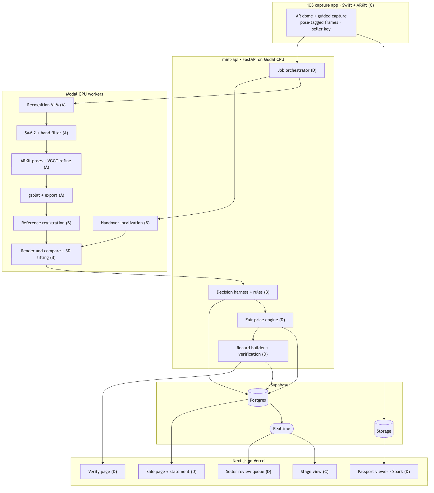

# Mint

**Make your belongings verifiable, priceable and liquid.**
Hack the Valley 11 · Theme: Sustainable FinTech & Economic Inclusion · Team of 4
Build window: Fri Oct 16 2026, 10:00 PM ET (H0) → Sun Oct 18, 8:00 AM ET (H34) · Judging: 4-minute pitch + 1 minute Q&A

> **New here? Read [CLAUDE.md](CLAUDE.md) first.** It's the full game plan and the source of truth; Claude Code loads it automatically. Set `export MINT_ROLE=A` (or B, C, D) in your shell.

---

## The problem

**Condition is the unpriced variable in second-hand money.** Model and age are easy to look up; condition isn't, so every second-hand deal is discounted for uncertainty. Pawnshops pay a fraction of value, lowballers exploit sellers who don't know what their item is worth, buyers get burned by hidden damage and fakes, and households sit on hundreds of dollars of unused belongings because pricing each item is too much work. Photos can't fix it: they never match a reference image's angle or light, so condition can't be measured from them.

## What Mint does

A 20-second **AR-guided phone scan** becomes a photoreal **3D Gaussian splat**. One engine, **render-and-compare**, does the rest. Because a splat can be rendered from any camera pose, it can be compared like for like with any other image:

| # | Use | Compared against | Result |
|---|---|---|---|
| 1 | **Listing condition** | The manufacturer's official reference images | Wear, damage and missing parts as glowing 3D regions, plus an identity check |
| 2 | **Fair price band** | Measured regions + comparable sales | A price band where every deduction links to a region |
| 3 | **Garage sale mode** | Many items in one session | A household asset statement and one sale page |
| 4 | **Handover** | The seller's own splat | Transit damage in red beside disclosed wear in amber, and a signed record both phones verify |

**Honest positioning:** Mint measures and flags; people decide. A coverage-verified scan means the seller can't hide the bad side. The identity check is a mismatch warning, not counterfeit certification.

## How it fits together

- **C's iOS app** (Swift + ARKit) captures pose-tagged frames and uploads them.
- **A's `Reconstructor`** (Modal GPU) recognises the item, masks it, refines ARKit poses with VGGT and trains the splat: scan → passport in **≤ 100 s**.
- **B's `Comparator`** (Modal GPU) registers 3–5 manufacturer photos onto the splat (IoU ≥ 0.85), finds anomalies that persist across references, checks identity and diffs handover rescans: **≤ 15 s per item**, **≤ 20 s per handover**. B's decision rules turn region features into typed verdicts.
- **D's price engine and records** (FastAPI on Modal CPU) turn verdicts into a deterministic, traceable price band and signed records. D's **Next.js** app serves the sale page, passport, review queue, statement, handover result and verify page.
- **C's stage view** makes every step visible on the big screen, live or replayed offline.
- **Supabase** (Postgres, Storage, Realtime) connects everything.

Sequence diagrams and internals: [ARCHITECTURE.md](ARCHITECTURE.md).

## Deploying the website (Vercel)

One Vercel project serves both Next.js apps from the repo root: [vercel.json](vercel.json) defines two services,
`buyer/` at `/` and `seller/` at `/sell` (the seller keeps `basePath: "/sell"`; Vercel passes the path through).
The Python stack stays on Modal, workspace **abhinavdave2020** (`modal deploy gsplat/app.py`).

1. Import the repo in Vercel with **Root Directory = the repo root** (not `buyer/`). Leave the framework,
   build and install settings empty: each service builds itself with its own pnpm lockfile.
2. Environment variables (Production + Preview). All are public values; no secret goes to Vercel:

   | Variable | Value |
   |---|---|
   | `NEXT_PUBLIC_SUPABASE_URL` | `https://jpanyhsifoxxiizkgjno.supabase.co` |
   | `NEXT_PUBLIC_SUPABASE_ANON_KEY` | the anon key (Supabase dashboard → Settings → API) |
   | `NEXT_PUBLIC_MINT_API_URL` | `https://abhinavdave2020--mint-gsplat-api.us-east.modal.run` |
   | `NEXT_PUBLIC_MINT_SCAN_LINK` | `mint://scan` |
   | `MINT_LIVE_LISTINGS` | optional; `0` hides live scans |

3. Deploy, then open `/` and `/sell`. `NEXT_PUBLIC_*` values are inlined at build time: redeploy after changing one.

After moving Modal to another workspace: `python gsplat/client.py urls` prints the new `api` URL (set it as
`NEXT_PUBLIC_MINT_API_URL` in Vercel and redeploy) and the webhook SQL to run once in Supabase.

## Docs

| Doc | What's in it |
|---|---|
| [CLAUDE.md](CLAUDE.md) | **The game plan:** features, decisions, hour-by-hour schedule, checkpoints, roles, invariants, workflow |
| [ARCHITECTURE.md](ARCHITECTURE.md) | Diagrams, coordinate conventions, the three pipelines, decision rules, price engine, records, contracts, API, events, data, deployment |
| [PRD.md](PRD.md) | Problem, users, hypothesis, metrics, scope, open questions, risks |
| [plans/role-A.md](plans/role-A.md) · [B](plans/role-B.md) · [C](plans/role-C.md) · [D](plans/role-D.md) | Per-role tasks with interfaces, fixtures, done-when and fallbacks |
| [contracts/](contracts/) | v3 JSON Schemas, price constants, canonical-JSON test vector |
| [DEMO.md](DEMO.md) | Pitch script, golden assets, failure runbook, Q&A, rehearsal log |
| [SPEC.md](SPEC.md) | The team's v3 source spec, verbatim |
| [docs/diagrams/](docs/diagrams/) | Diagram sources and rendered PNGs |

## Checkpoints

| ★ | ET | Caller | Pass |
|---|---|---|---|
| H1 | Fri 11 PM | All | Contracts locked; Modal image builds; Next.js + Supabase deployed; Xcode project runs on device |
| H4 | Sat 2 AM | C | AR dome anchored and filling; frames + poses upload |
| H6 | Sat 4 AM | A | Real AR scan → splat viewable in browser |
| H10 | Sat 8 AM | B | Reference registered with IoU ≥ 0.85 on one object |
| H13 | Sat 11 AM | B | Anomaly regions on 3 objects; handover diff on one pair |
| H16 | Sat 2 PM | D | Price band, review queue, sale page, signed record end to end |
| H20 | Sat 6 PM | C | Full demo on a new object; demo mode offline. **Feature freeze** |
| H23 | Sat 9 PM | D | Initial Devpost |
| H26 | Sun 12 AM | B | Evaluation numbers and baselines |
| H29 | Sun 3 AM | B | Live registration ≤ 15 s, handover ≤ 20 s, 3 of 3 |
| H32 | Sun 6 AM | D | 3 clean timed rehearsals |
| H34 | Sun 8 AM | D | Final submission |
