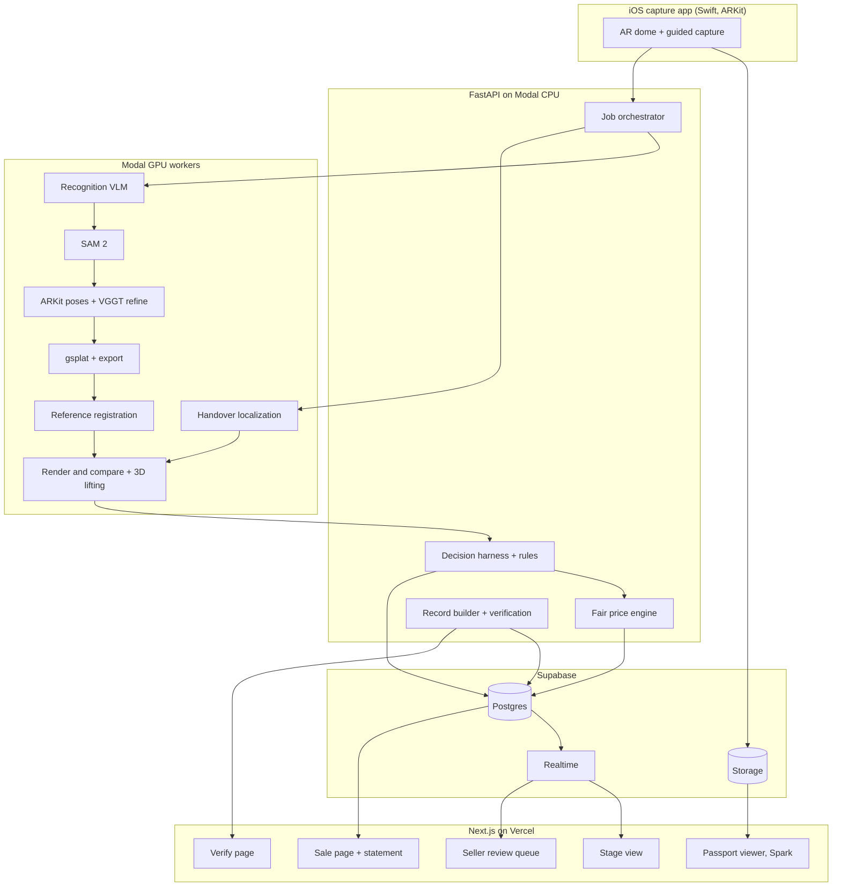

# Mint: Project Specification (v3)

> **Source spec, saved verbatim as provided by the team.** The working game plan is [CLAUDE.md](CLAUDE.md), which adds decisions this spec leaves open (pose conventions, image orientation, integer-only records, price constants, handover adjustment, sleep shifts and so on; see [CLAUDE.md §8](CLAUDE.md#8-decisions-log)). Where they differ, CLAUDE.md wins. Note: section 4.1's Mermaid block may not render in every viewer; the rendered version is [docs/diagrams/v3-overview.png](docs/diagrams/v3-overview.png).

**Make your belongings verifiable, priceable and liquid.**
Hack the Valley 11 · Team of 4 · Theme: Sustainable FinTech & Economic Inclusion
Build window: Fri Oct 16, 10:00 PM ET (H0) to Sun Oct 18, 8:00 AM ET (H34) · Judging: 4-minute pitch + 1 minute Q&A

---

## 0. How to use this document

This is the single source of truth for Mint. Claude Code should generate from it:

1. `ARCHITECTURE.md`: components, contracts, sequence diagrams, deployment, latency budget, demo mode.
2. `PRD.md`: problem, users, goals and non-goals, features with acceptance criteria, metrics, risks.
3. `plans/role-A.md` to `plans/role-D.md`: ordered tasks per role mapped to checkpoints, with inputs, outputs (by contract), fixtures and definition of done.
4. `contracts/`: JSON Schemas (plus Pydantic and TypeScript types) for every contract in section 7.
5. `DEMO.md`: script, timings, golden assets, fallbacks, Q&A answers.

Principles for every plan:

- **Narrow vertical slices with review gates.** Every gate ends in something demoable end to end.
- **Deterministic first, models second.** Geometry, rules and math decide wherever possible. Learned models and LLMs handle only what can't be computed.
- **Fixture discipline.** Build and test against real scans and real reference images, never invented data.
- **Contracts before code.** Lock section 7 in the first hour.
- **Show the tech.** The demo must make the pipeline visible, not just the result.

---

## 1. The problem

**Condition is the unpriced variable in second-hand money.** A product's model and age are easy to look up. Its condition isn't, so every second-hand transaction gets discounted for uncertainty, and the people with the least leverage lose the most:

- **Pawnshops and resale stores** pay a fraction of value because they can't trust condition.
- **Lowballers** exploit sellers who don't know what their item is worth.
- **Buyers who rely on second-hand** get burned by hidden damage, misdescribed items and fakes.
- **Households sit on unused belongings** worth hundreds of dollars because pricing and listing each item is too much work.

Photos don't fix this. They're cropped, taken at flattering angles, lit differently each time, and never match a reference image or an earlier photo, so condition can't be measured from them.

## 2. The solution

Mint turns a 20-second AR-guided phone scan into a photoreal 3D Gaussian splat, then uses one engine, **render-and-compare**, to measure condition objectively:

1. **Listing:** the splat is compared against the manufacturer's official reference images to find wear, damage and missing parts, and to check the item matches its claimed model.
2. **Fair price band:** market value from comparable sales × a condition multiplier from the measured evidence, with every deduction linked to a highlighted 3D region.
3. **Garage sale mode:** scan many items in one session and get a **household asset statement** (each item's condition, fair price band, and total), then publish them all on one sale page.
4. **Handover:** at delivery, the buyer's quick rescan is compared against the seller's splat to detect transit damage, producing a signed, tamper-evident record.

**Pitch:** *Mint makes your belongings verifiable, priceable and liquid.*
**Why 3D:** a photo can't be re-rendered to match a reference image's angle. A splat can, which is what makes like-for-like comparison possible.

### Theme fit

| Theme phrase | Mint |
|---|---|
| Expand financial access | Turns unused belongings into fairly priced cash |
| Empower underserved communities | Removes the information gap that lets pawnshops and lowballers underpay |
| Equitable economic growth | Both sides of every deal see the same objective price evidence |
| Financial literacy | A transparent price breakdown tied to measured evidence |

**Pitch extension (not built):** a verified condition record lets possessions serve as collateral for fair micro-loans instead of predatory pawn rates.

### Honest positioning

- Mint **measures and flags**; people make the final call. Sellers confirm flagged regions before publishing, and buyers can inspect any angle themselves.
- A **coverage-verified** scan means the seller can't hide the bad side, which no photo listing can guarantee.
- The identity check is a **mismatch warning**, not counterfeit certification.

---

## 3. Features

### 3.1 Must-have

| ID | Feature | Owner | Done when |
|---|---|---|---|
| M1 | **AR-guided capture:** user taps the item, an AR dome anchors to it, segments fill as the user walks around at two heights; each sharp frame is saved with its ARKit camera pose and intrinsics; upload starts automatically at about 90% coverage | C | 20 to 25 s scan reaches 90% coverage on 3 of 3 demo objects; frames + poses land in storage |
| M2 | **Live recognition:** the first sharp frame is uploaded immediately; one VLM call returns label, brand, model, colour variant, category and a bounding box; shown on phone and stage during the scan | A (C for live UI) | Model shown within 5 s of scan start on 3 of 3 demo objects |
| M3 | **Object isolation:** SAM 2 video masking seeded by the box; frames with a hand on the object dropped | A | Splat contains only the item |
| M4 | **Splat:** ARKit poses refined with VGGT, gsplat training on a warm Modal GPU, compressed web export, keyframe index for tap-for-photo, metric scale from ARKit | A | Scan to viewable passport in 100 s or less |
| M5 | **Reference retrieval:** 3 to 5 official reference images per item (curated for demo objects; image search as best effort) | A | References present for 3 of 3 demo objects |
| M6 | **Reference registration:** each reference image's camera pose is solved against the splat (feature matching to splat renders, then render-and-optimize refinement on silhouette and features) | B | Silhouette IoU ≥ 0.85 after refinement on at least 3 references per demo object |
| M7 | **Condition detection vs. references:** render the splat at each registered reference pose, apply colour normalization and lighting-tolerant DINOv2 features, flag local anomalies that persist across multiple references, lift to 3D, cluster into regions with features | B | Known wear on demo objects detected; clean surfaces produce at most 2 false regions per object |
| M8 | **Identity check:** silhouette and geometry agreement with references produces a match score and a mismatch warning below threshold | B | Correct model passes; a deliberately wrong reference set triggers the warning |
| M9 | **Decisions:** Jev classifies each region (class, severity, confidence); rules in code apply thresholds and route uncertain regions to seller confirmation | B | Every region gets a typed verdict in under 5 s per item |
| M10 | **Fair price band:** market value from comparable sales (curated for demo objects) × condition multiplier from confirmed regions; band width grows with uncertainty; each deduction linked to a region | D | Same inputs always give the same band; every dollar traces to a region or a comp |
| M11 | **Seller review queue:** swipe through drafted listings, confirm or dismiss flagged regions, accept or edit the price within the band | D | A 5-item batch can be reviewed in under a minute |
| M12 | **Garage sale mode + household statement:** batch of items with per-item condition, price band and a total; publish as one sale page | D | Statement and sale page render for a pre-baked 8-item batch |
| M13 | **Passport viewer:** splat orbit on phone (drag, tilt to look), glowing regions, coverage-verified badge, tap-for-real-photo, price breakdown; opens from QR without an app | D | Judge opens a QR and inspects an item on their own phone |
| M14 | **Handover check:** buyer rescan localized into the seller splat's space (feature matching inside the mask + PnP), render and compare, new regions glow red next to disclosed regions (amber) | B (engine), D (UI) | Sticker and marker line detected; no-change rescan gives at most 2 regions; result in 20 s or less |
| M15 | **Signed records:** canonical JSON, SHA-256, Ed25519 with the seller key on the capture phone and the buyer key in the buyer's browser; verify page | D | Editing one byte fails verification; signatures from two devices |
| M16 | **Pipeline stage view:** big-screen view that visualizes registration snapping into place, the anomaly heatmap, noise fading, and the price band building line by line | C | Plays for live and cached runs |
| M17 | **Demo mode:** golden cache for every step with a subtle replay indicator | C, A | Full demo runs with Wi-Fi off |
| M18 | **Evaluation:** labelled set, precision and recall, registration accuracy, photo-only baseline, Jev vs. simple classifier | B, D | Numbers ready by H26 |

### 3.2 Nice-to-have (only after gate 4)

| ID | Feature | Owner |
|---|---|---|
| N1 | **Inbox agent:** answers buyer questions with the exact rendered view ("is the bottom scratched?") and accepts or counters offers within seller rules | D |
| N2 | **Two-agent settlement** for handover damage (seller and buyer agents with private limits, arbiter in code) | D |
| N3 | **Measure tool** on the passport | D |
| N4 | **Underside flip pass** merged into the splat | A, C |
| N5 | **Calibration chart** for the pitch | B |

### 3.3 Cut

Real payments or escrow. Real marketplace posting (no APIs; terms of service). Turntables, marker boards or any extra hardware. On-device splat training. Blockchain. Shiny, glass or transparent demo objects.

---

## 4. Architecture

### 4.1 Overview



### 4.2 Pipeline 1: scan to passport

1. **Capture (iOS).** User taps the item; a raycast onto the detected surface places an anchor; an AR dome of segments at two elevations appears. As the user walks around, the app computes the direction from anchor to camera each frame and saves sharp frames that fill empty segments, with ARKit pose and intrinsics. Exposure, focus and white balance lock at scan start. About 50 to 60 frames, 20 to 25 s.
2. **Live recognition.** The first sharp frame uploads immediately; the VLM returns label, brand, model, variant, category and box, broadcast over Realtime.
3. **Masking.** SAM 2 video mode tracks the item from the box; frames where a hand overlaps the object are dropped.
4. **Poses.** ARKit poses (metric scale) are the initialization; VGGT refines them on masked frames.
5. **Training.** gsplat on a warm GPU with masked frames and alpha supervision, tuned for the 100 s budget; compressed web export; keyframe index (pose, sharpness) for tap-for-photo.
6. **Seal.** SHA-256 of frames manifest and splat; seller phone signs the hash.

**Capture fallback:** Apple Object Capture on a LiDAR iPhone as the front end; or hand-held video with VGGT poses and coverage shown after upload.

### 4.3 Pipeline 2: condition vs. references (the core)

1. **Retrieve references:** 3 to 5 official images for the recognized model and variant (curated for demo objects).
2. **Coarse pose:** render the splat from a sphere of candidate viewpoints; match DINOv2 global features and silhouettes against each reference to pick the nearest view.
3. **Fine pose:** match local features (ALIKED or SuperPoint + LightGlue) between the reference and the nearest render, lift render keypoints to 3D with splat depth, solve PnP-RANSAC; then refine with render-and-optimize on silhouette IoU and feature alignment.
4. **Render and normalize:** render the splat at the solved pose and resolution; segment the reference product from its background; apply colour and exposure normalization (histogram matching inside the mask).
5. **Local anomaly map:** DINOv2 patch distance plus local Lab difference, high-pass to suppress global lighting differences; keep anomalies that persist across at least 2 registered references.
6. **Lift and cluster:** back-project anomalies to 3D with splat depth; HDBSCAN into regions; compute region features.
7. **Identity check:** aggregate silhouette IoU and geometric agreement across references into a match score; below threshold, show a mismatch warning.
8. **Decide:** Jev classifies regions; rules route results (section 4.5).

### 4.4 Pipeline 3: handover check

1. Buyer scans with the same AR app (10 s, about 25 frames).
2. Each frame is localized into the seller splat's coordinates (feature matching inside the object mask, PnP-RANSAC against splat depth).
3. The seller splat is rendered at each pose and compared with the real photo (exposure normalization, DINOv2 + Lab difference inside the mask).
4. Changed pixels are lifted to 3D and clustered; Jev classifies; regions that match disclosed listing regions stay amber, new regions glow red.
5. A record is built with both scan hashes, regions and any adjustment, signed by both devices.

### 4.5 Decisions

| Question | Output |
|---|---|
| Class | Probabilities over `wear`, `damage`, `missing_part`, `dirt_or_smudge`, `removable_addition`, `scan_artifact` |
| Severity | 0 to 1 |
| Present before (handover only) | Probability the region was already disclosed |

**Engine:** Jev (TypeSafe) on structured region features. **Fallback:** calibrated logistic regression and gradient boosting trained on the evaluation set's region features (also the baseline Jev is compared against).

**Rules in code:**
- Top class probability ≥ 0.85: accepted automatically. 0.5 to 0.85: sent to seller confirmation. Below 0.5: shown as uncertain and excluded from price.
- A region measured consistently in ≥ 70% of seeing views can't be dropped as an artifact by any model.
- `removable_addition` and `dirt_or_smudge` never reduce price; they appear as notes.
- Thresholds are tuned on the evaluation set, and the pitch says so.

### 4.6 Fair price engine

```
market_value   = median of comparable used sales for the model and variant
condition      = 1 - Σ(class_weight × severity × area_factor) over confirmed regions, floored
price_mid      = market_value × condition_multiplier(condition)
band_width     = base_width + k × (share of regions that are uncertain or unconfirmed)
price_band     = [price_mid - band_width/2, price_mid + band_width/2]
```

- Comparable sales are curated per demo object (with sources listed); live retrieval is out of scope.
- Every deduction is a ledger line linked to a 3D region; every market value cites its comps.
- The engine is deterministic and unit-tested.

### 4.7 Signed records

Canonical JSON (sorted keys, no whitespace), SHA-256, Ed25519. Seller key generated on the capture phone; buyer key generated in the buyer's browser (tweetnacl-js). Verify page recomputes the hash and checks both signatures. Honest limit: the hash proves integrity after capture, not authenticity of the capture; device attestation and C2PA are extensions.

### 4.8 Latency budget

| Step | Budget |
|---|---|
| Upload (hotspot) | 15 s |
| Recognition + masking | 15 s |
| Pose refinement | 10 s |
| gsplat training + export | 60 s |
| **Scan to passport** | **100 s or less** |
| Reference registration + comparison (per item, 3 to 5 references) | 15 s |
| **Handover check** | **20 s or less** |

GPU containers warm before judging, weights preloaded on a Modal volume.

---

## 5. Experience and brand

**Name:** Mint ("mint condition" + minting a verified record). **Motif:** a minted seal for verified passports, a stamp when records are signed, subtle banknote guilloche texture on statements and verify pages. **Palette:** mint green accent; near-black stage background; warm off-white phone pages; amber for disclosed regions, red for new damage, grey for artifacts. **Voice:** calm, short, slightly witty ("Found 2 real marks. Ignored 31 lighting differences.").

**Make the tech visible (stage view):**

| Moment | Visual |
|---|---|
| Capture | AR dome segments filling; model name pops up mid-scan |
| Splat reveal | Points densify into the photoreal item, slow auto-rotate |
| **Registration** | The manufacturer image floats over the 3D model and snaps into alignment as the pose is solved, with the IoU ticking up |
| Anomaly map | Heatmap on the aligned render; dozens of candidate spots fade away, real wear stays and glows |
| Price band | Ledger lines build one at a time, each linked to a glowing region; band narrows as regions are confirmed |
| Statement | Item cards stack into a household total |
| Handover | Red glow appears next to amber; wipe slider at the exact angle |
| Seal | Stamp animation, QR, verify check sweeps across the hash |

Screens: iOS capture; seller review queue; sale page; passport; household statement; handover result; verify page; stage view. Tools: Spark (three.js), Framer Motion, SVG for the dome and seal.

---

## 6. Demo (4 minutes)

| Time | Beat | Live or cached |
|---|---|---|
| 0:00 to 0:20 | **Hook:** "Pawnshops pay a fraction of what your things are worth because they can't trust condition." | Live |
| 0:20 to 0:55 | **Scan:** AR scan of a demo item, dome filling, model pops up | Live capture; splat from an earlier scan of the same item ("training takes about 90 seconds; here's this item scanned earlier") |
| 0:55 to 1:45 | **Registration and condition:** the manufacturer images snap onto the 3D model one by one; anomaly heatmap; noise fades; real wear glows; identity check passes | **Live on the cached splat** (about 15 s) |
| 1:45 to 2:20 | **Fair price band:** ledger builds, each deduction tied to a region; seller confirms one uncertain region in the review queue | Live |
| 2:20 to 2:45 | **Garage sale:** household statement for a pre-baked 8-item batch; judges open the sale page QR and inspect items on their phones | Cached data, live viewing |
| 2:45 to 3:35 | **Handover:** the judge adds a sticker and a marker line; 10 s rescan; new red regions appear next to amber disclosed ones; wipe slider; judge signs on their phone | **Live** (about 20 s) |
| 3:35 to 4:00 | **Close:** proof numbers (registration accuracy, precision, photo-only baseline) and "Mint makes your belongings verifiable, priceable and liquid." | Live |

**Demo integrity:** the replay indicator shows on cached steps; if asked, state exactly what was live and give real timings.

**Fallbacks:** registration fails on a reference → skip to the next reference; handover localization fails → rescan slower, else golden result; Jev down → fallback classifier; Wi-Fi down → hotspot, then demo mode; laptop fails → backup video on two phones.

**Q&A prep:**

| Question | Answer |
|---|---|
| Why not compare photos to the stock image? | Angles never match. We solve the reference camera's pose against the splat and render the exact same view. Photo-only baseline: [X] false regions vs. [Y]. |
| Studio vs. room lighting? | Colour normalization, lighting-tolerant features, high-pass local differences, and anomalies must persist across multiple references. |
| Who decides damage? | Mint measures and flags; sellers confirm; buyers inspect any angle themselves. |
| Is the price fair? | Comparable sales × measured condition, every deduction traceable, band widens with uncertainty. |
| Counterfeits? | We flag geometric mismatch with the reference model; we don't certify authenticity. |
| How accurate? | Numbers on our labelled set, with its size stated. |
| What doesn't work? | Shiny, glass and transparent items; heavily customized items without references. |

---

## 7. Contracts

### 7.1 Capture manifest (C → A)
```json
{"scan_id":"uuid","item_id":"uuid","batch_id":"uuid","kind":"listing | handover",
 "frames":[{"index":0,"path":"scans/{scan_id}/f000.jpg","t_ms":0,
   "pose":[[...4x4...]],"intrinsics":[[...3x3...]],"sharpness":0.82,"segment":"az090_el20"}],
 "anchor":[0,0,0],"coverage_pct":91,"width":1080,"height":1440,"created_at":"ISO-8601"}
```

### 7.2 Passport (A → B, D)
```json
{"scan_id":"uuid","label":"over-ear headphones","brand":"Sony","model":"WH-1000XM4","variant":"black",
 "splat_path":"splats/{scan_id}.spz","metric_scale":1.0,"keyframes":[{"index":0,"pose":[[...]],"sharpness":0.81}],
 "coverage_pct":91,"sha256":"hex","seller_sig":"base64",
 "references":[{"ref_id":"uuid","path":"refs/...jpg","source":"url"}]}
```

### 7.3 Registration (B → D, stage)
```json
{"ref_id":"uuid","pose":[[...]],"intrinsics":[[...]],"silhouette_iou":0.91,"inliers":142,
 "render_path":"renders/...png","anomaly_map_path":"maps/...png","status":"ok | failed"}
```

### 7.4 Region (B → D)
```json
{"region_id":"uuid","scan_id":"uuid","source":"reference | handover","centroid":[0.01,0.12,-0.03],
 "radius_m":0.012,"part":"left ear cup","area_cm2":1.8,"lab_delta":14.2,"feature_dist":0.41,
 "views_agreeing":4,"views_seeing":5,"evidence":[{"render":"...","photo":"..."}]}
```

### 7.5 Verdict (B → D)
```json
{"region_id":"uuid","class_probs":{"wear":0.81,"damage":0.1,"missing_part":0.01,"dirt_or_smudge":0.04,
 "removable_addition":0.02,"scan_artifact":0.02},"severity":0.3,"present_before_prob":null,
 "decision":"accepted | needs_confirmation | uncertain | dropped","engine":"jev | fallback"}
```

### 7.6 Price band (D → web)
```json
{"item_id":"uuid","market_value_cad":180,"comps":[{"price_cad":175,"source":"..."}],
 "condition":0.86,"price_mid_cad":152,"price_band_cad":[140,164],
 "ledger":[{"region_id":"uuid","label":"scuff, left ear cup","delta_cad":-12,"confidence":0.91}],
 "identity_match":0.93}
```

### 7.7 Record (D → verify)
Canonical JSON with item, scan hashes, regions and verdicts, price band or adjustment, timestamp, both public keys; signatures stored alongside over the SHA-256.

### 7.8 API

| Method | Path | Purpose |
|---|---|---|
| POST | `/batches` | Start a garage sale batch |
| POST | `/scans` | Register a scan, start Pipeline 1 |
| GET | `/scans/{id}` | Status, passport |
| POST | `/items/{id}/condition` | Run Pipeline 2 |
| POST | `/items/{id}/confirm/{region_id}` | Seller confirms or dismisses |
| GET | `/items/{id}/price` | Price band |
| GET | `/batches/{id}/statement` | Household statement |
| POST | `/deals/{id}/handover` | Run Pipeline 3 |
| POST | `/deals/{id}/sign` | Party signature |
| GET | `/verify/{record_id}` | Verification |
| GET | `/keyframe?scan_id&point=x,y,z` | Tap-for-photo |

Realtime: one channel per batch and per deal for stage updates.

Tables: `batches`, `items`, `scans`, `keyframes`, `references`, `registrations`, `regions`, `verdicts`, `prices`, `deals`, `records`, `demo_cache`.

---

## 8. Roles

| Role | Owns |
|---|---|
| **A: reconstruction** | Modal GPU image and warm containers; recognition VLM; SAM 2 masking and hand-frame filter; ARKit pose ingestion + VGGT refinement; gsplat training and export; keyframe index; reference image curation; golden scans |
| **B: comparison engine** | Splat rendering at arbitrary poses; reference registration (coarse + fine + refinement); anomaly maps; 3D lifting and clustering; identity check; handover localization and diff; Jev integration, fallback classifier, rules; evaluation and baselines |
| **C: capture and stage** | Swift ARKit capture app (tap-to-anchor, AR dome, pose-tagged frames, live recognition display, upload); stage view with pipeline visualizations (registration snap, heatmap, noise fade); demo mode and golden cache |
| **D: product, money and trust** | Next.js app (sale page, passport viewer, review queue, statement, handover result, verify page); fair price engine and comps; signed records; Supabase schema; Devpost and pitch lead (all four rehearse) |

---

## 9. Evaluation

- **Dataset:** 3 to 5 matte, textured objects with official reference images; per object a listing scan, 3 handover scans with logged changes, 2 no-change rescans; wear on each object logged by hand.
- **Region-level labels:** regions overlapping logged wear or changes are positives; others are artifacts.
- **Metrics:** registration silhouette IoU and pose success rate; anomaly precision and recall vs. references; handover precision and recall; false regions per clean scan; latencies.
- **Baseline 1:** photo-only comparison against references (homography alignment) vs. splat render-and-compare.
- **Baseline 2:** Jev vs. calibrated logistic regression on the same features.

---

## 10. Timeline and gates

| Checkpoint | ET | Caller | Pass |
|---|---|---|---|
| H1 | Fri 11 PM | All | Contracts locked; Modal image builds; Next.js + Supabase deployed; Xcode project runs on device |
| H4 | Sat 2 AM | C | AR dome anchored and filling; frames + poses upload |
| H6 | Sat 4 AM | A | Real AR scan → splat viewable in browser |
| H10 | Sat 8 AM | B | Splat rendered at a reference pose with IoU ≥ 0.85 on one object |
| H13 | Sat 11 AM | B | Anomaly regions vs. references on 3 objects; handover diff on one pair |
| H16 | Sat 2 PM | D | Price band, review queue, sale page and signed record end to end |
| H20 | Sat 6 PM | C | Full demo on a new object with stage visualizations; demo mode offline. **Feature freeze** |
| H23 | Sat 9 PM | D | Initial Devpost |
| H26 | Sun 12 AM | B | Evaluation numbers and baselines |
| H29 | Sun 3 AM | B | Live registration ≤ 15 s and handover ≤ 20 s, 3 of 3 |
| H32 | Sun 6 AM | D | 3 clean timed rehearsals |
| H34 | Sun 8 AM | D | Final submission |

**Gates:** (1) scan → passport; (2) registration + condition vs. references; (3) price band + review + sale page; (4) handover + signed record; (5) stage visualizations, brand, demo mode; (6) stretch only after gate 4.

Sleep in two shifts so the build never stops.

---

## 11. Stack

| Layer | Choice | Fallback |
|---|---|---|
| Capture | Swift + ARKit (SwiftUI, RealityKit for the dome) | Apple Object Capture (LiDAR iPhones) or hand-held video + VGGT |
| Recognition | One VLM call | Manual label |
| Masking | SAM 2 | rembg |
| Poses | ARKit, refined by VGGT | VGGT only |
| Splat | gsplat on Modal (A100/L4) | Fewer iterations, lower resolution |
| Registration | DINOv2 global + silhouettes (coarse), ALIKED/SuperPoint + LightGlue + PnP (fine), render-and-optimize | Coarse pose only, best reference kept |
| Comparison | DINOv2 patch features, Lab difference, histogram matching | Lab difference only |
| Clustering | HDBSCAN | DBSCAN |
| Decisions | Jev (TypeSafe) | Calibrated logistic regression + gradient boosting |
| Price | Deterministic Python engine, curated comps | Fixed comps table |
| Records | Canonical JSON, SHA-256, Ed25519 (PyNaCl, tweetnacl-js) | Hash only |
| Backend | FastAPI on Modal CPU | Local FastAPI |
| Data | Supabase | SQLite + local files |
| Web | Next.js on Vercel, Spark, Framer Motion | GaussianSplats3D |

---

## 12. Risks

| Risk | Mitigation |
|---|---|
| Studio vs. phone lighting dominates the comparison | Normalization, lighting-tolerant features, high-pass, multi-reference persistence; test on one object in the first hours |
| Reference images are renders or different variants | Curate for demo objects; keep only references with IoU ≥ 0.85 |
| Registration fails on symmetric objects | Multiple references; choose asymmetric demo objects |
| AR app takes too long | C starts at H0; Object Capture or hand-held fallback by H6 |
| Splat misses 100 s | Warm GPU, fewer frames and iterations; cached splat in the demo script |
| Jev access or latency | Fallback classifier by H16 |
| Scope | Gates, freeze at H20, stretch only after gate 4 |

---

## 13. Pre-hack checklist

- [ ] Confirm Jev access and latency
- [ ] Build the Modal GPU image; time one splat on L4 and A100
- [ ] Mac + Xcode + iPhone ready; check whether anyone has a LiDAR iPhone
- [ ] Pick 3 to 5 matte, textured, asymmetric demo objects with official reference images; save references and comps with sources
- [ ] Draft brand: mark, palette, type, seal
- [ ] Read the hacker package for judging time and prizes; confirm roles
